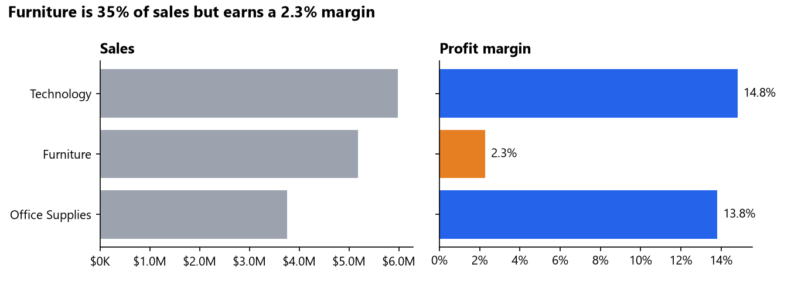
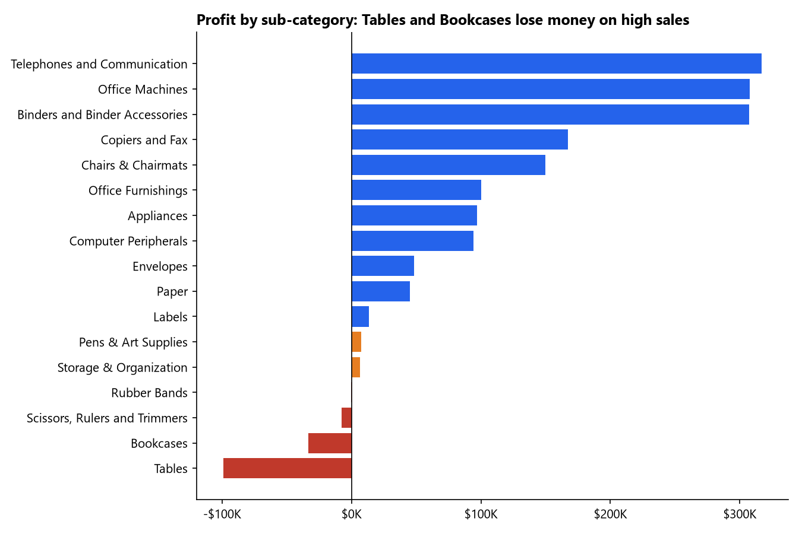
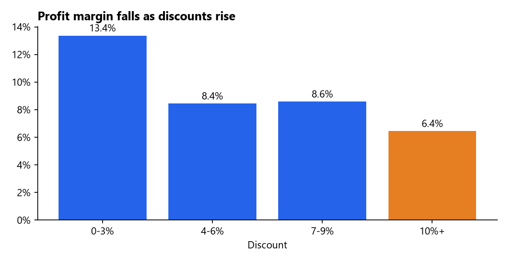
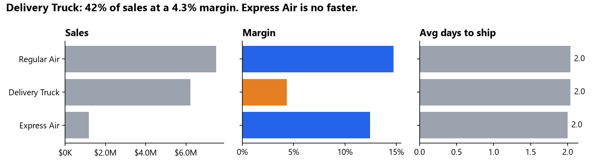
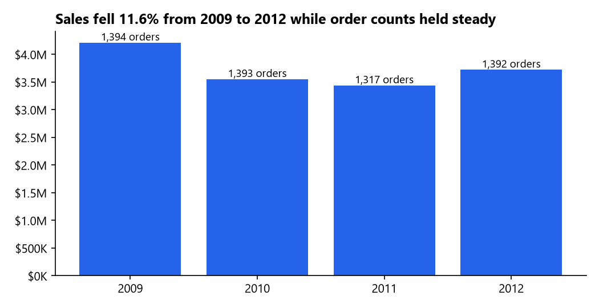

# Superstore Sales Performance Dashboard

**Python data cleaning → star schema → Power BI dashboard**

An office supplies retailer selling across Canada had four years of order data (2009 to 2012, 8,399 order lines, $14.9M in sales) and a simple question: where is the money actually being made, and where is it being lost?

**Live summary page:** https://superstore-sales-analysis-phi.vercel.app (source in [`site/index.html`](site/index.html))



## Key findings

| | Finding | Why it matters |
|---|---|---|
| 1 | **Furniture is 35% of sales but earns only a 2.3% margin**, against 14.8% for Technology and 13.8% for Office Supplies. | A third of revenue contributes less than 8% of profit. |
| 2 | **Tables lose $99K (‑5.2% margin) and Bookcases lose $34K (‑4.1%).** They are the 2nd and 8th biggest sub-categories by sales. | High-volume products are being sold below cost. |
| 3 | **Half of all order lines (50.8%) lose money**, adding up to $1.10M in losses that the profitable lines have to cover. | Profit depends on a minority of orders. |
| 4 | **Margin falls as discounts rise:** 13.4% at 0 to 3% discount, about 8.5% at 4 to 9%, and 6.4% at 10% or more. | Discounting is eroding margin. |
| 5 | **Delivery Truck carries 42% of sales at a 4.3% margin**, while Regular Air earns 14.7%. Two-thirds of truck sales are furniture. | Shipping and furniture problems are linked. |
| 6 | **Express Air ships in about 2.0 days, the same as Regular Air.** Low-priority orders take 4.2 days on average versus about 1.5 for everything else. | The premium shipping option isn't buying speed. |
| 7 | **2012 sales were 11.6% below 2009**, while order counts held steady around 1,390 a year. | Order values are shrinking, not order volume. |
| 8 | The top 20% of customers bring in 46% of sales. Corporate is the largest segment (37% of sales). | Revenue is spread widely; no single-customer dependency. |

## Charts

Generated with Python (`scripts/make_charts.py`, matplotlib).









## Recommendations
1. Review pricing and discount limits on Tables and Bookcases first; they turn the most revenue into losses.
2. Require approval for discounts of 10% or more, where margin is less than half the low-discount level.
3. Check whether Express Air is worth its cost when it delivers no faster than Regular Air.
4. Investigate the fall in average order value since 2009.

## Data cleaning (Python, pandas)

`scripts/clean_and_model.py` runs every check below and writes the results to `data_clean/data_quality_log.csv`.

| Check | Result | Action |
|---|---|---|
| Misspelled or outdated province/region names ("Saskachewan", "Prarie", "Newfoundland") | 1,788 rows | Corrected to official names |
| Missing product base margin | 63 rows | Filled with sub-category median |
| Customers listed under several segments | 176 customers | Segment kept on the fact table (segment at time of order) |
| Order IDs shared by more than one customer | 21 orders | Kept and documented |
| Products with inconsistent attributes | 26 products | Most common value used |
| Very large orders (3×IQR) | 582 rows | Kept, flagged `is_large_order` |
| Loss-making lines | 4,264 rows | Kept, flagged `is_loss` |
| Duplicates, bad dates, ship-before-order, negative sales | 0 | Checked |

## Data model

Star schema built in Python and loaded into Power BI:

```
                 dim_date
                    │
dim_customer ── fact_sales ── dim_product
                    │
              dim_geography
```

- **fact_sales** (8,399 rows): sales, profit, quantity, discount, shipping cost, days to ship, flags
- **dim_product** (1,263), **dim_customer** (795), **dim_geography** (13 provinces), **dim_date** (2009 to 2012)

## Dashboard pages
1. **Executive Overview**: sales, profit, margin, orders, YoY trend, map by province
2. **Product Profitability**: profit by sub-category, sales vs margin scatter, loss analysis
3. **Discounts & Shipping**: margin by discount band, ship mode cost and speed
4. **Customers**: top customers, segment mix, concentration

DAX measures are in `powerbi/dax_measures.md` (time intelligence, ranking, conditional formatting).

## Tools
Python (pandas, matplotlib) · Power BI · DAX · Power Query · star-schema data modelling

## How to run
```bash
pip install pandas matplotlib
python scripts/clean_and_model.py   # clean data + star schema -> data_clean/
python scripts/make_charts.py       # README charts -> images/
```
Then build the dashboard in Power BI Desktop, or follow `powerbi/build_guide.md` to rebuild it.

The web summary in `site/` is a single static HTML file. To host it on Vercel, import this repo and set the **Root Directory** to `site`.

## Data source
Tableau "Superstore Sales" sample dataset (fictional retailer, Canada, 2009 to 2012), via [curran/data](https://github.com/curran/data/tree/gh-pages/superstoreSales).
